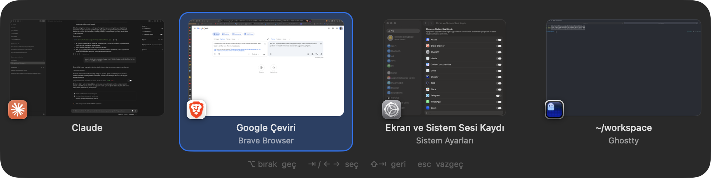
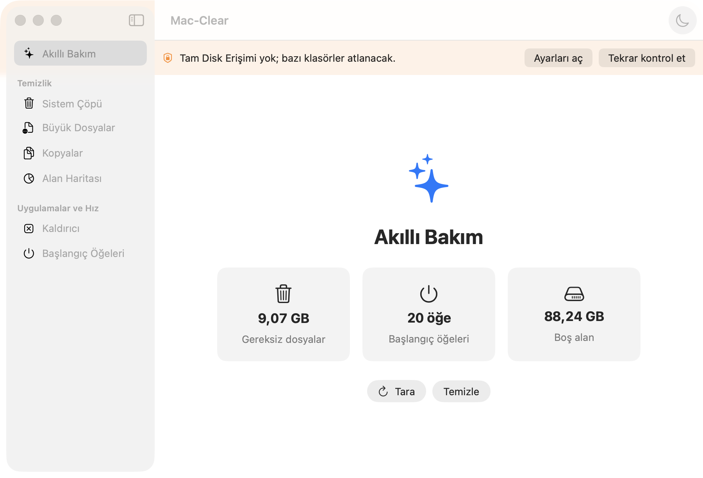

# mac-apps

Küçük, bağımlılıksız, yerel macOS uygulamaları. Hepsi Swift ile yazılır, tek komutla derlenir ve aynı sabit sertifikayla imzalanır.

| Uygulama | Ne yapar |
|---|---|
| [**Alt-Tab**](alt-tab/README.md) | ⌥Tab ile canlı pencere önizlemeli pencere değiştirici (menü çubuğu uygulaması) |
| [**Mac-Clear**](mac-clear/README.md) | Disk temizleyici ve alan analizcisi |
| **Tabula** | Finder'da sağ tık → Yeni Dosya (txt, md, json, csv, html, py, sh); türler `tabula/Extension/FinderSync.swift` içindeki listede |

## Gereksinimler

- macOS 14 veya üstü (Apple Silicon)
- Xcode Command Line Tools: `xcode-select --install`

## Kurulum

```bash
git clone https://github.com/mustafacavusoglu/mac-apps.git && cd mac-apps
./build.sh --install             # hepsini derle, /Applications'a kur ve aç
./build.sh --install alt-tab     # yalnız biri
./build.sh                       # yalnız derle → <uygulama>/build/<Ad>.app
```

İlk derlemede betik, anahtar zincirine **mac-apps Dev** adlı kendinden imzalı bir kod imzalama sertifikası ekler.

**Neden?** Ad-hoc imza her derlemede değişir. macOS da verdiğiniz izinleri (Erişilebilirlik, Ekran Kaydı, Tam Disk Erişimi) unutur. Sertifika aynı kaldığı için izinler güncellemelerden sonra da korunur.

**Güvenlik:**
- Sertifikanın özel anahtarı dışarı aktarılamaz.
- Anahtarı soru sormadan yalnız `codesign` kullanabilir.
- Uygulamalar *hardened runtime* ile imzalanır. Böylece başka bir program `DYLD_INSERT_LIBRARIES` ile uygulamaya kod sokup izinlerini ödünç alamaz.

## Uygulamalar

### [Alt-Tab](alt-tab/README.md)


Windows'taki Alt+Tab'ın macOS karşılığı. ⌥Tab'a basınca açık pencereler canlı önizlemeleriyle görünür. Menü çubuğunda çalışır. → [Ayrıntılar](alt-tab/README.md)

<br clear="left">



### [Mac-Clear](mac-clear/README.md)


Disk temizleyici ve alan analizcisi. Sistem çöpü, büyük dosyalar, kopyalar, alan haritası, uygulama kaldırıcı ve başlangıç öğeleri bölümleri var. → [Ayrıntılar](mac-clear/README.md)

<br clear="left">



## Depo yapısı

```
mac-apps/
├── build.sh              ortak derleme, imzalama, kurulum
├── alt-tab/
│   ├── README.md  Info.plist  Package.swift
│   ├── Sources/AltTab/   main · Hotkey · Switcher · Tile · Windows · StatusItem
│   ├── Resources/        AppIcon.icns
│   ├── tools/            make_icon.swift
│   └── docs/             ekran görüntüleri
└── mac-clear/
    ├── README.md  Info.plist  Package.swift
    ├── Sources/MacClear/
    ├── Resources/
    └── docs/             ekran görüntüsü
```

**Yeni uygulama eklemek için:**
1. `README.md`, `Info.plist`, `Package.swift` ve `Resources/AppIcon.icns` dosyalarını içeren bir klasör açın.
2. `CFBundleExecutable` değeri SwiftPM ürün adıyla aynı olsun.
3. `./build.sh` bu klasörü kendiliğinden bulur.
