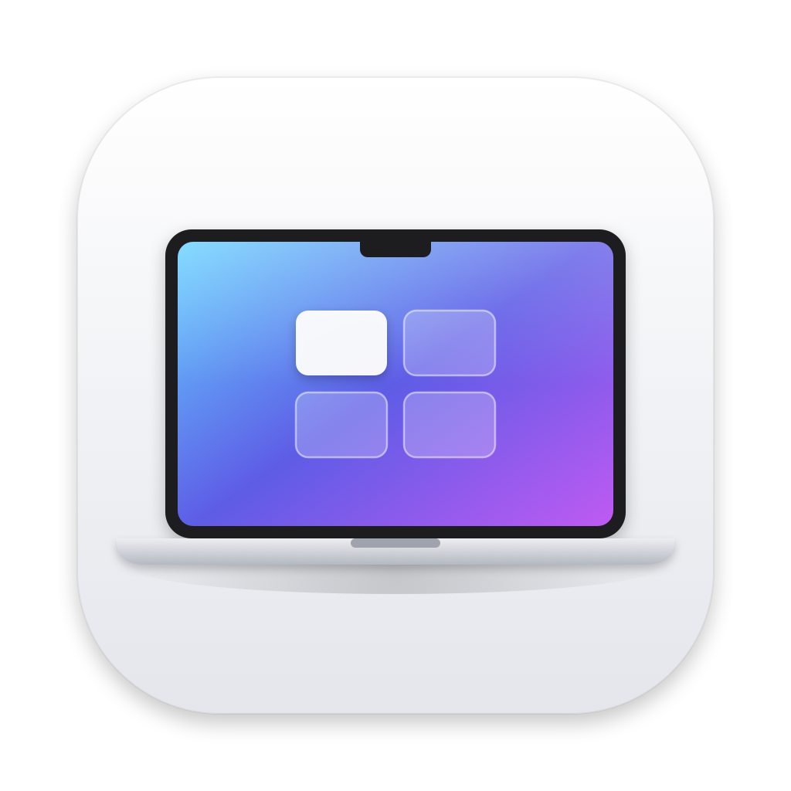
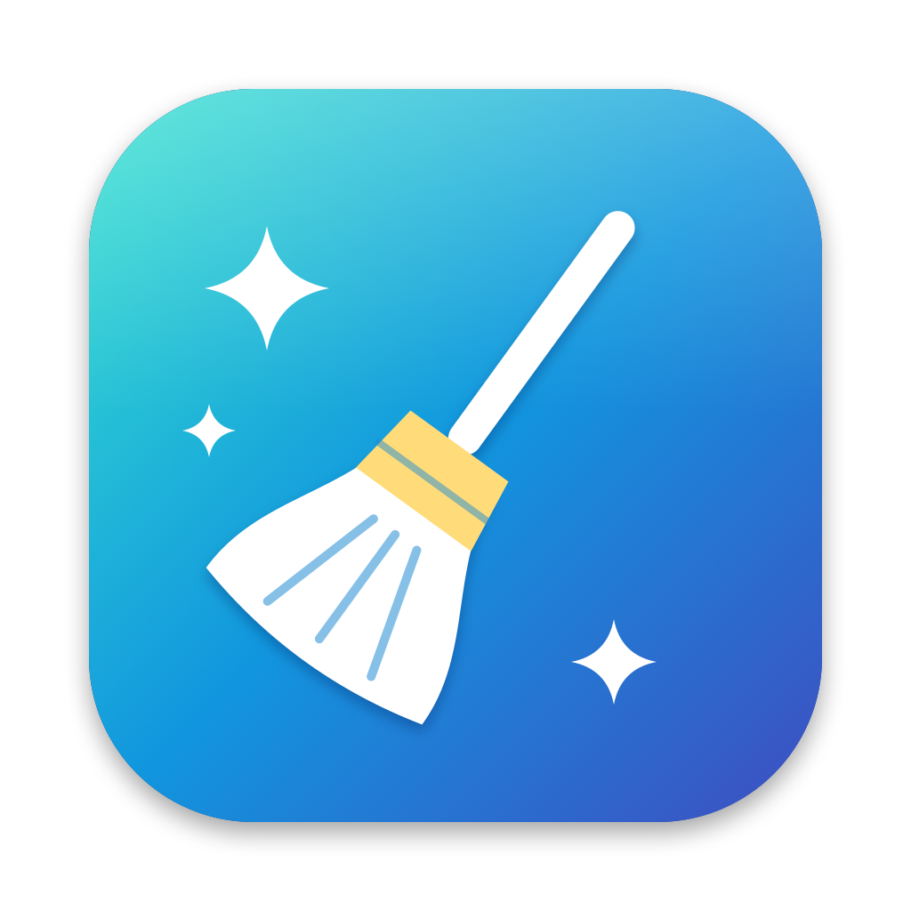
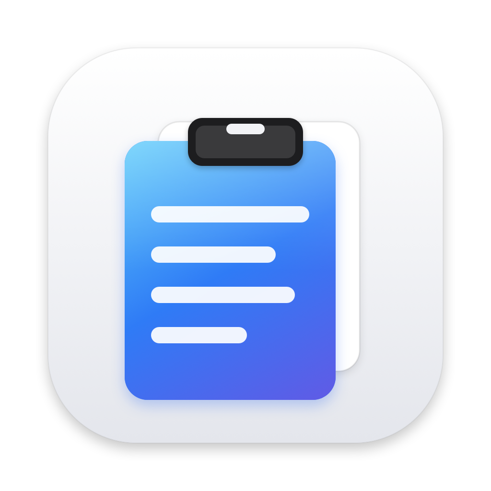

# mac-apps

Küçük, yerel macOS uygulamaları. Hepsi Swift ile yazılır, tek komutla derlenir.

İki türlü kullanılır:

- **macOne**: hepsi tek uygulamada; istediğin özelliği aç, gerisini kapat.
- **Tek tek**: her uygulama kendi klasöründe, ayrı bir uygulama olarak da durur.



### [macOne](macone/README.md)

Menü çubuğunda tek uygulama. Pano geçmişi, Finder'da kes/taşı, Alt-Tab, Mac-Clear, hız testi ve [Stats](https://github.com/exelban/stats). Her özellik macOne simgesinden açılıp kapanır.

<br clear="left">

## Uygulamalar

| | Uygulama | Ne yapar |
|---|---|---|
|  | [**macOne**](macone/README.md) | Hepsi bir arada, özellik başına aç/kapat |
|  | [**Alt-Tab**](alt-tab/README.md) | ⌥Tab ile canlı önizlemeli pencere değiştirici |
|  | [**Mac-Clear**](mac-clear/README.md) | Disk temizleyici ve alan analizcisi |
|  | [**Finder-Plus**](finder-plus/README.md) | Finder'da sağ tık Yeni Dosya, ⌘X / ⌘V ile taşıma, Burada Terminal Aç |
|  | [**Copy-Hist**](copy-hist/README.md) | Menü çubuğunda sade pano geçmişi |
|  | [**Speed-Test**](speed-test/README.md) | Menü çubuğunda canlı ibreli hız testi (Cloudflare) |

## Kurulum

Gereksinimler: macOS 14+ (Apple Silicon) ve Xcode. macOne, Stats'ı derlediği için tam Xcode ister; diğerlerine Command Line Tools yeter.

```bash
git clone --recurse-submodules https://github.com/mustafacavusoglu/mac-apps.git
cd mac-apps
./build.sh --install macone      # hepsi bir arada
./build.sh --install alt-tab     # ya da yalnız biri
```

`./build.sh <klasör>` yalnız derler, çıktı `<klasör>/build/<Ad>.app` olur. Klasör vermezsen hepsini derler.

macOne'ı kurduysan aynı özelliklerin tek başına sürümlerini kapat. Yoksa ⌥Tab, pano ve ⌘X / ⌘V iki kez yakalanır.

## İmza ve izinler

İlk derlemede anahtar zincirine **mac-apps Dev** adlı kendinden imzalı bir sertifika eklenir. Her uygulama bununla imzalanır.

- **Neden:** ad-hoc imza her derlemede değişir. macOS da verdiğin izinleri (Erişilebilirlik, Ekran Kaydı, Tam Disk Erişimi) unutur. Sertifika sabit olunca izinler güncellemelerden sonra da kalır.
- **Güvenlik:**
  - Özel anahtar dışarı aktarılamaz.
  - Anahtarı yalnız `codesign` kullanabilir.
  - Uygulamalar *hardened runtime* ile imzalanır; başka bir program kod sokup izinleri ödünç alamaz.

## Yapı

Her uygulama kendi klasöründe bir Swift paketidir; her klasörün README'sinde ekran görüntüsü var. Özellik kodu `…Kit` kütüphanesinde durur. Tek başına uygulama da macOne da aynı kütüphaneyi kullanır, kod kopyalanmaz.

```
mac-apps/
├── build.sh        ortak derleme, imzalama, kurulum
├── macone/         hepsi bir arada (+ vendor/stats alt modülü)
├── alt-tab/        AltTabKit + uygulama
├── mac-clear/      MacClearKit + uygulama
├── finder-plus/    FinderPlusKit + uygulama + Finder eklentisi
├── copy-hist/      CopyHistKit + uygulama
└── speed-test/     SpeedTestKit + uygulama
```

Yeni uygulama eklemek için `Info.plist`, `Package.swift` ve `README.md` içeren bir klasör aç. `CFBundleExecutable`, SwiftPM ürün adıyla aynı olsun. `./build.sh` klasörü kendisi bulur.

## Lisans

[Stats](https://github.com/exelban/stats) MIT lisanslıdır ve `macone/vendor/stats` altında alt modül olarak durur.
