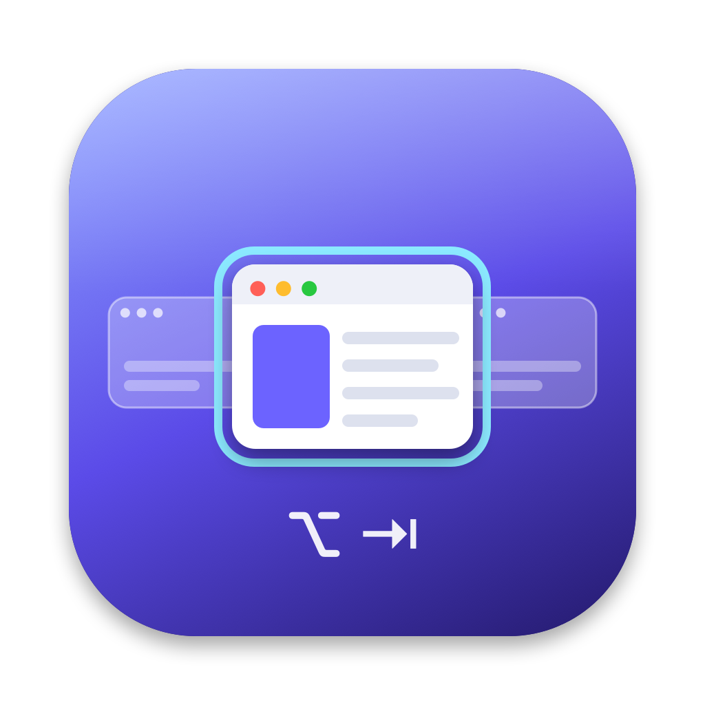

# mac-apps

Küçük, bağımlılıksız, yerel macOS uygulamaları. Hepsi Swift ile yazılır, tek komutla derlenir ve aynı sabit sertifikayla imzalanır.

| Uygulama | Ne yapar |
|---|---|
| [**Alt-Tab**](alt-tab/README.md) | ⌥Tab ile canlı pencere önizlemeli pencere değiştirici (menü çubuğu uygulaması) |
| [**Mac-Clear**](mac-clear/README.md) | Disk temizleyici ve alan analizcisi |
| [**Tabula**](tabula/README.md) | Finder sağ tık menüsü ve ⌘X/⌘V: Yeni Dosya, Kes/Taşı, Burada Terminal Aç |
| [**Copy-Hist**](copy-hist/README.md) | Menü çubuğunda sade pano geçmişi: son 10 kayıt görünür, en fazla 50 kayıt kaydırılır |

## Gereksinimler

- macOS 14 veya üstü (Apple Silicon)
- Xcode Command Line Tools: `xcode-select --install`

## Kurulum

```bash
git clone https://github.com/mustafacavusoglu/mac-apps.git && cd mac-apps
./build.sh --install             # hepsini derle, /Applications'a kur ve aç
./build.sh --install alt-tab     # yalnız biri
./build.sh                       # yalnız derle → <uygulama>/build/<Ad>.app
```

İlk derlemede betik, anahtar zincirine **mac-apps Dev** adlı kendinden imzalı bir kod imzalama sertifikası ekler.

**Neden?** Ad-hoc imza her derlemede değişir. macOS da verdiğiniz izinleri (Erişilebilirlik, Ekran Kaydı, Tam Disk Erişimi) unutur. Sertifika aynı kaldığı için izinler güncellemelerden sonra da korunur.

**Güvenlik:**
- Sertifikanın özel anahtarı dışarı aktarılamaz.
- Anahtarı soru sormadan yalnız `codesign` kullanabilir.
- Uygulamalar *hardened runtime* ile imzalanır. Böylece başka bir program `DYLD_INSERT_LIBRARIES` ile uygulamaya kod sokup izinlerini ödünç alamaz.

## Uygulamalar

### [Alt-Tab](alt-tab/README.md)



Windows'taki Alt+Tab'ın macOS karşılığı. ⌥Tab'a basınca açık pencereler canlı önizlemeleriyle görünür. Menü çubuğunda çalışır. → [Ayrıntılar](alt-tab/README.md)

<br clear="left">


### [Mac-Clear](mac-clear/README.md)


Disk temizleyici ve alan analizcisi. Sistem çöpü, büyük dosyalar, kopyalar, alan haritası, uygulama kaldırıcı ve başlangıç öğeleri bölümleri var. → [Ayrıntılar](mac-clear/README.md)

<br clear="left">


### [Tabula](tabula/README.md)


Windows'tan gelenler için Finder sağ tık menüsü: **Yeni Dosya** (txt, md, json, csv, html, py, sh), **Kes / Buraya Taşı** (⌘X / ⌘V dahil) ve **Burada Terminal Aç**. Finder eklentisi olarak çalışır. → [Ayrıntılar](tabula/README.md)

<br clear="left">

### [Copy-Hist](copy-hist/README.md)

Menü çubuğunda sade pano geçmişi. Kopyaladığın metinleri saklar, tek tıkla panoya geri koyar. Kaydırmadan 10 kayıt görünür, toplam en fazla 50 kayıt tutulur. → [Ayrıntılar](copy-hist/README.md)


## Depo yapısı

```
mac-apps/
├── build.sh              ortak derleme, imzalama, kurulum
├── alt-tab/
│   ├── README.md  Info.plist  Package.swift
│   ├── Sources/AltTab/   main · Hotkey · Switcher · Tile · Windows · StatusItem
│   ├── Resources/        AppIcon.icns
│   ├── tools/            make_icon.swift
│   └── docs/             ekran görüntüleri
├── mac-clear/
│   ├── README.md  Info.plist  Package.swift
│   ├── Sources/MacClear/
│   ├── Resources/
│   └── docs/             ekran görüntüsü
├── copy-hist/
│   ├── README.md  Info.plist  Package.swift
│   ├── Sources/CopyHist/ App · Config · Clip · Store · Watcher · MenuView
│   ├── tools/            snapshot.swift
│   └── docs/             ekran görüntüsü
└── tabula/
    ├── README.md  Info.plist  Package.swift  post-build.sh
    ├── Sources/Tabula/   ana uygulama: main · Shortcuts (⌘X/⌘V)
    ├── Shared/           uygulama + eklenti ortak kodu
    ├── Extension/        FinderSync (menü) · Actions · Files · Types
    ├── Resources/        AppIcon.icns
    ├── tools/            make_icon.swift
    └── docs/             ikon
```

**Yeni uygulama eklemek için:**
1. `README.md`, `Info.plist`, `Package.swift` ve `Resources/AppIcon.icns` dosyalarını içeren bir klasör açın.
2. `CFBundleExecutable` değeri SwiftPM ürün adıyla aynı olsun.
3. `./build.sh` bu klasörü kendiliğinden bulur.
