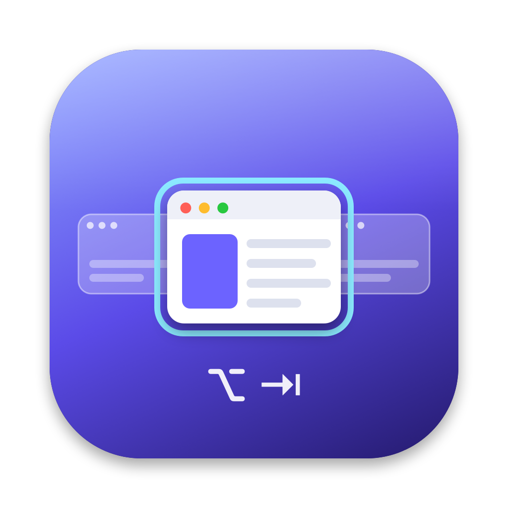
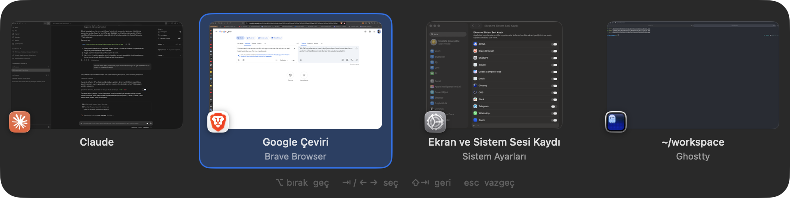

# Alt-Tab



Windows'taki Alt+Tab'ın macOS karşılığı. Açık pencereleri canlı küçük resimleriyle gösterir.



## Kurulum

Deponun kökünden:

```bash
./build.sh --install alt-tab   # derle, /Applications'a kur ve aç
./build.sh alt-tab             # yalnız derle → alt-tab/build/Alt-Tab.app
```

Gereksinimler, imza sertifikası ve diğer uygulamalar için [ana README](../README.md)'ye bakın.

## Kısayollar

| Tuş | İşlev |
|---|---|
| ⌥ basılıyken ⇥ | Sonraki pencere |
| ⌥ basılıyken ⇧⇥ | Önceki pencere |
| ← → ↑ ↓ | Panelde gezin |
| ⌥ bırak / ↩ / tıkla | Seçili pencereye geç |
| esc | Vazgeç |

## Özellikler

- Hızlı ⌥Tab'da panel hiç görünmeden bir önceki pencereye geçer.
- Her pencerenin ScreenCaptureKit ile alınmış küçük resmi ve köşesinde uygulama rozeti gösterilir.
- Pencereler son kullanılma sırasına göre dizilir. Çok pencere varsa satırlara bölünür.
- Panel macOS 26'da Liquid Glass, önceki sürümlerde buzlu cam görünümündedir. Açık/koyu temaya ve vurgu rengine uyar.
- Dock ikonu yoktur, menü çubuğunda çalışır.

## İzinler (ilk açılışta bir kez sorulur)

- **Erişilebilirlik:** ⌥Tab'ı yakalamak ve pencereyi öne almak için zorunludur. Uygulama tuşlara yalnız ⌥Tab için bakar; hiçbir tuşu kaydetmez.
- **Ekran Kaydı:** Küçük resimler için gereklidir. İzin verilmezse uygulama ikonları gösterilir. Görüntüler yalnız bellekte tutulur, diske yazılmaz.

İzin verdikten sonra uygulamayı yeniden başlatmanız gerekmez.

## Sınırlar

Yalnız geçerli Space'teki ve küçültülmemiş pencereler listelenir. Bu sürümde Login Items'a ekleme ayarı yoktur. Açılışta başlaması için: Sistem Ayarları → Genel → Giriş Öğeleri.

## Geliştirici araçları

```bash
build/Alt-Tab.app/Contents/MacOS/alt-tab --list           # pencere listesini yaz
build/Alt-Tab.app/Contents/MacOS/alt-tab --preview p.png  # paneli PNG'ye çek
swift tools/make_icon.swift                               # ikonu yeniden üret
```
