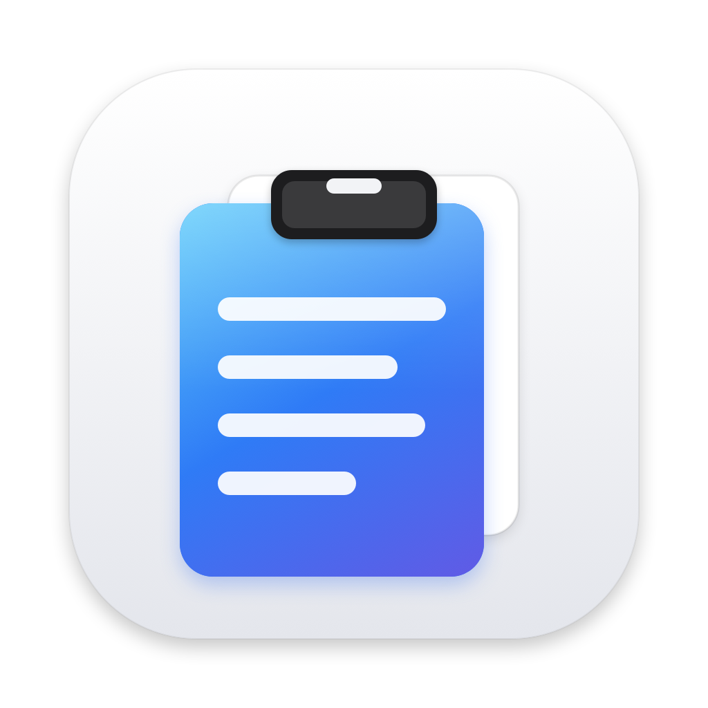
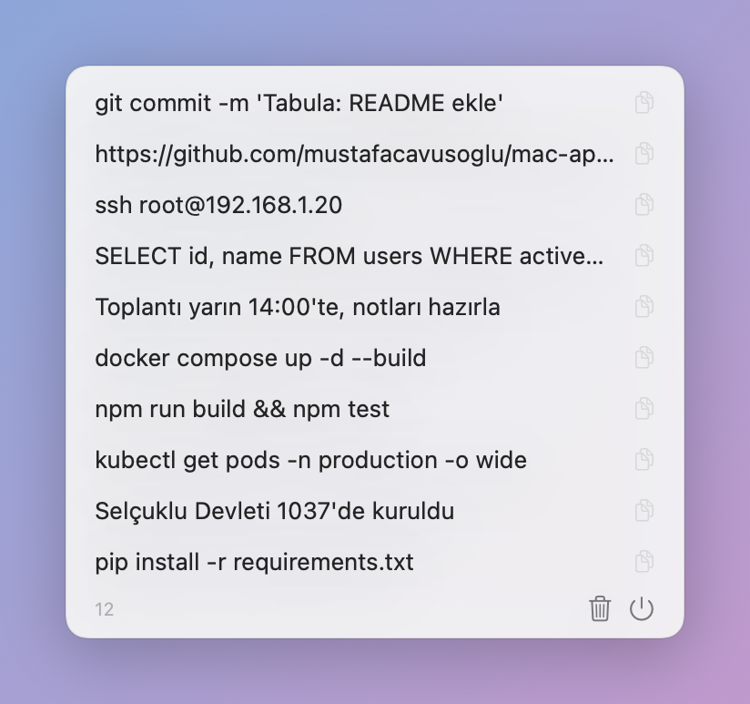

# Copy-Hist



Menü çubuğunda yaşayan, sade pano geçmişi. Kopyaladığın metinleri saklar, birine tıklayınca panoya geri koyar.



## Kurulum

Deponun kökünden:

```bash
./build.sh --install copy-hist   # derle, /Applications'a kur ve aç
./build.sh copy-hist             # yalnız derle → copy-hist/build/Copy-Hist.app
```

Gereksinimler ve imza sertifikası için [ana README](../README.md)'ye bakın.

## Kullanım

- Menü çubuğundaki pano simgesine tıkla. Tek bir kaydırılabilir liste açılır, aynı anda **10** kayıt görünür. Aşağı kaydırdıkça en fazla **50** kayda kadar eskiler gelir.
- Satıra tıkla → metin panoya kopyalanır, panel kapanır, kayıt listenin başına çıkar.
- Satırın üzerine gelince **×** ile o kayıt silinir. Alttaki çöp kutusu hepsini siler, güç simgesi uygulamadan çıkar.
- Aynı metin tekrar kopyalanırsa yeni kayıt açılmaz, eskisi öne alınır.

## Gizlilik

- Geçmiş yalnız bu Mac'te `~/Library/Application Support/Copy-Hist/history.json` dosyasında durur. Ağ bağlantısı yoktur.
- Parola yöneticilerinin gizli ya da geçici diye işaretlediği pano içeriği (`org.nspasteboard.ConcealedType` / `TransientType`) kaydedilmez.
- Yalnız düz metin saklanır. 100.000 karakterden uzun metinler atlanır.

## Yapı

```
copy-hist/
├── Info.plist  Package.swift
├── Sources/CopyHist/
│   └── App.swift        giriş, menü çubuğu öğesi
├── Sources/CopyHistKit/ (kitaplık; macOne da kullanır)
│   ├── Public.swift     clipboardHistoryStart/Stop, ClipboardHistoryMenu
│   ├── Config.swift     tüm sabitler (10 / 50, yoklama süresi, dosya yolu)
│   ├── Clip.swift       kayıt modeli
│   ├── Store.swift      liste, tekrar kontrolü, sınır, diske yazma
│   ├── Watcher.swift    pano yoklama, panoya geri yazma
│   └── MenuView.swift   panel ve satır arayüzü
├── tools/snapshot.swift ekran görüntüsünü örnek verilerle üretir
├── tools/make_icon.swift ikon: swift tools/make_icon.swift
├── Resources/AppIcon.icns
└── docs/            icon.png · screenshot.png
```

Ekran görüntüsü, arayüz örnek verilerle çizilerek üretilir (gerçek geçmiş kullanılmaz):

```bash
cd copy-hist
swiftc -parse-as-library -o /tmp/snap tools/snapshot.swift $(ls Sources/CopyHistKit/*.swift)
/tmp/snap docs/screenshot.png
```

## Kaynak

Tasarım, [CopyClip](https://fiplab.com/apps/copyclip-for-mac)'in paket yapısı ve metin dizeleri üzerinden yapılan tersine mühendislik analizinden esinlenmiştir (REA ile; yalnız davranış ve ayar listesi çıkarıldı, kod alınmadı). Kısayol, arama, yok sayılan uygulamalar ve otomatik yapıştırma bilerek yoktur.
