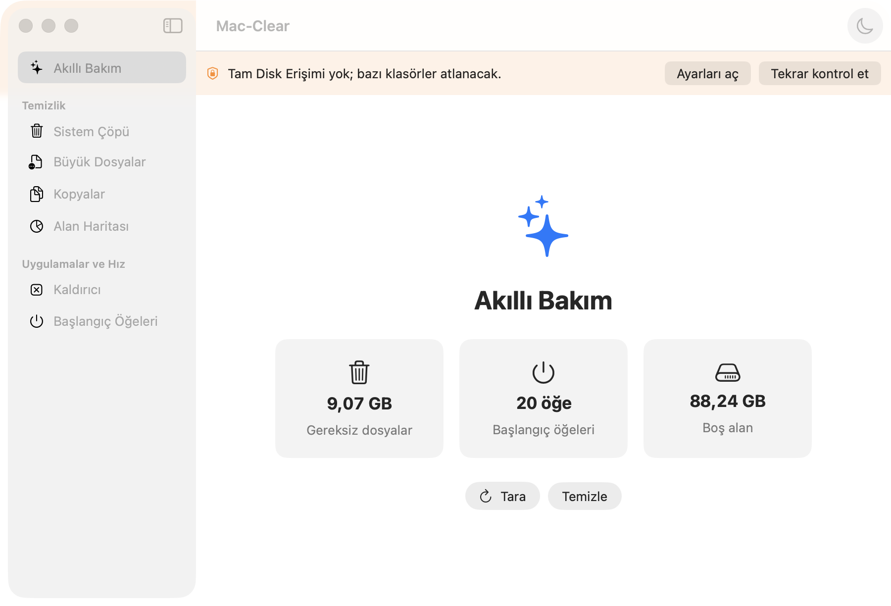

# Mac-Clear


Disk temizleyici ve alan analizcisi. Çoğu işlem dosyaları **Çöp Sepeti'ne taşır**, bu yüzden "Geri al" ile geri alınabilir. Kalıcı silme her zaman onay ister.



## Kurulum

Deponun kökünden:

```bash
./build.sh --install mac-clear   # derle, /Applications'a kur ve aç
./build.sh mac-clear             # yalnız derle → mac-clear/build/Mac-Clear.app
```

Gereksinimler, imza sertifikası ve diğer uygulamalar için [ana README](../README.md)'ye bakın.

## Bölümler

| Bölüm | Ne yapar |
|---|---|
| **Akıllı Bakım** | Tek tıkla tarama yapar. Gereksiz dosya boyutunu, başlangıç öğesi sayısını ve boş alanı gösterir, varsayılan seçimle temizler. |
| **Sistem Çöpü** | Önbellekleri, günlükleri, çökme raporlarını, Xcode artıklarını, npm/yarn/pnpm/gradle/cargo/Maven önbelleklerini ve Çöp Sepeti'ni temizler. Klasör ağacında tek tek seçim yapılabilir. |
| **Büyük Dosyalar** | Ev klasöründe 100 MB / 500 MB / 1 GB / 5 GB üstü dosyaları bulur. |
| **Kopyalar** | Aynı içerikli dosyaları SHA-256 ile bulur. Her gruptan en az bir dosya korunur. |
| **Alan Haritası** | Klasör klasör boyut çubukları gösterir. Disk dizini FSEvents ile canlı güncellenir. |
| **Kaldırıcı** | Uygulamayı ~/Library'deki kalıntılarıyla birlikte kaldırır. Kalıntılar yalnız tam bundle id eşleşmesiyle bulunur. |
| **Başlangıç Öğeleri** | LaunchAgent/Daemon'ları listeler. Kullanıcı öğelerini durdurup kaldırır. |

## Güvenlik ağı

- Yalnız ev klasörünün içi ve `/Applications/*.app` silinebilir.
- Ev klasörünün kendisi, `~/Belgeler` gibi kök klasörler ve `~/Library/*` kökleri korunur.
- Symlink'ler ve `..` çözülür. Her öğe silinmeden hemen önce yeniden denetlenir.
- Her işlem `~/Library/Logs/Mac-Clear.log` dosyasına yazılır.
- Uygulama ağ erişimi kullanmaz.

## İzinler

- **Tam Disk Erişimi** önerilir. Verilmezse korumalı klasörler atlanır ve uygulama bir uyarı şeridi gösterir.
- Root'a ait öğeleri taşırken macOS yönetici parolası sorar.

## Geliştirici araçları

```bash
build/Mac-Clear.app/Contents/MacOS/mac-clear --selftest      # güvenlik ağı + silme/geri alma testleri
build/Mac-Clear.app/Contents/MacOS/mac-clear --du ~/Library  # hızlı klasör boyutu
```
