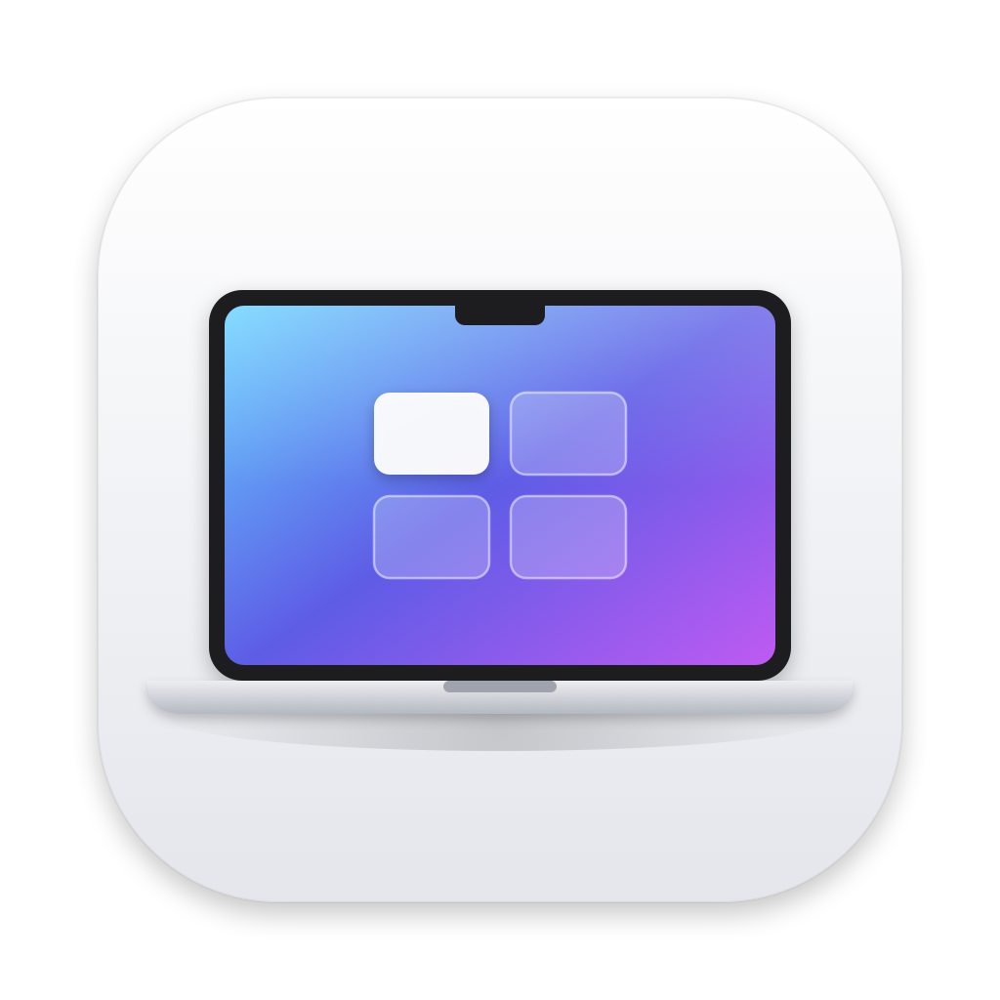

# macOne



Depodaki uygulamaların tek uygulamada birleşimi. Pano Geçmişi ve Hız Testi'nin **menü çubuğunda kendi simgesi** var; tıklayınca Stats'taki gibi bir panel açılır. Mac-Clear macOne simgesinin panelinden açılır. Arka planda çalışan Alt-Tab ve Kes/Taşı simgesizdir, yalnız açık/kapalı. Açıp kapatma, macOne simgesindeki anahtarlarla ya da Ayarlar'dan yapılır. Kapalı bir özellik hiç çalışmaz ve simgesi görünmez.

| Özellik | Kaynak | Menü çubuğu simgesi |
|---|---|---|
| Pano Geçmişi | [Copy-Hist](../copy-hist/README.md) | panel: geçmiş listesi |
| Kes / Taşı ve Finder menüsü | [Tabula](../tabula/README.md) | simge yok; Finder'da ⌘X / ⌘V, sağ tık |
| Alt-Tab | [Alt-Tab](../alt-tab/README.md) | simge yok; ⌥Tab |
| Mac-Clear | [Mac-Clear](../mac-clear/README.md) | simge yok; macOne simgesi → Mac-Clear'ı aç |
| Hız Testi | macOne | panel: canlı ibreli hız testi (Cloudflare, 4 paralel bağlantı) |
| Stats | [exelban/stats](https://github.com/exelban/stats) (MIT) | Stats'ın kendi simgeleri; modülleri Stats'ın ayarlarından seç |

Standalone uygulamalar olduğu gibi duruyor. Her birinin kodu kendi paketindeki `…Kit` kütüphanesinde, macOne da aynı kütüphaneleri kullanır. Böylece kod tek yerde kalır.

## Kurulum

Deponun kökünden:

```bash
./build.sh --install macone   # derle, /Applications'a kur ve aç
./build.sh macone             # yalnız derle → macone/build/macOne.app
```

İlk derleme Stats'ı Xcode ile derlediği için birkaç dakika sürer. Bu adım tam Xcode gerektirir. Stats, `vendor/stats` alt modülünden gelir. Alt modül boşsa betik onu kendisi indirir.

## Notlar

- İlk açılışta tüm özellikler açık gelir. İstemediklerini Ayarlar'dan kapat.
- **Oturum açılınca başlat** Ayarlar'ın en üstünde, varsayılan kapalı. Açılınca macOS'un Giriş Öğeleri listesine eklenir (SMAppService); kapalıyken macOne'ı kendin açarsın.
- Alt-Tab ile Kes/Taşı Erişilebilirlik iznini, Alt-Tab Ekran Kaydı iznini ister. İzinler uygulama başına verilir; tek başına Alt-Tab'ın izni macOne'a geçmez. Ekran Kaydı izni yoksa Alt-Tab'da pencere önizlemesi yerine yalnız uygulama simgesi görünür. İzni verip macOne'ı yeniden başlat; Ayarlar'daki uyarıda iki düğme de var.
- İkon: `swift tools/make_icon.swift` (macone klasöründen) `Resources/AppIcon.icns` ve `docs/icon.png` üretir.
- Stats'ın hangi modülleri (CPU, RAM, disk, ağ, sensörler, pil…) gösterdiği Stats'ın kendi ayarlarından seçilir. Kurulu /Applications/Stats.app varsa macOne onu açar, yoksa kendi içindeki kopyayı. Stats zaten çalışıyorsa ikinci kopya açılmaz; macOne'dan kapatılınca o da kapanır. İçteki kopya kendinden imzalı olduğu için `stats.entitlements` ile kütüphane doğrulaması yalnız Stats sürecinde kapalı.
- Bir simgeyi ⌘ basılıyken menü çubuğundan dışarı sürüklersen o özellik kapanır.
- Finder eklentisi Tabula ile aynı kimliği kullanır. Tabula ile macOne'ı aynı anda kurma; sağ tık menüsü ikisinden birine bağlanır.
- Tasarım kontrolü: `macone/.build/release/macOne --snapshot <klasör>` menü, ayarlar ve hız testi ekranlarını PNG'ye yazar.

## Yapı

```
macone/
├── Package.swift        ../alt-tab, ../copy-hist, ../tabula, ../mac-clear kütüphanelerine bağlı
├── post-build.sh        Finder eklentisi + Stats.app'i pakete koyar ve imzalar
├── tools/build-stats.sh Stats'ı Release derler
├── vendor/stats/        exelban/stats (git alt modülü)
└── Sources/macOne/
    ├── App.swift        menü çubuğu + pencereler
    ├── Feature.swift    özellik modeli ve açık/kapalı durumu
    ├── MenuView.swift   macOne simgesinin paneli (aç/kapat anahtarları)
    ├── FeatureMenus.swift simgelere tıklayınca açılan paneller
    ├── SettingsView.swift
    ├── Snapshot.swift   --snapshot
    ├── Permissions.swift Ekran Kaydı izni (Alt-Tab önizlemesi)
    └── Features/        Catalog · FinderExtension · SpeedTestModel/View · StatsFeature
```
