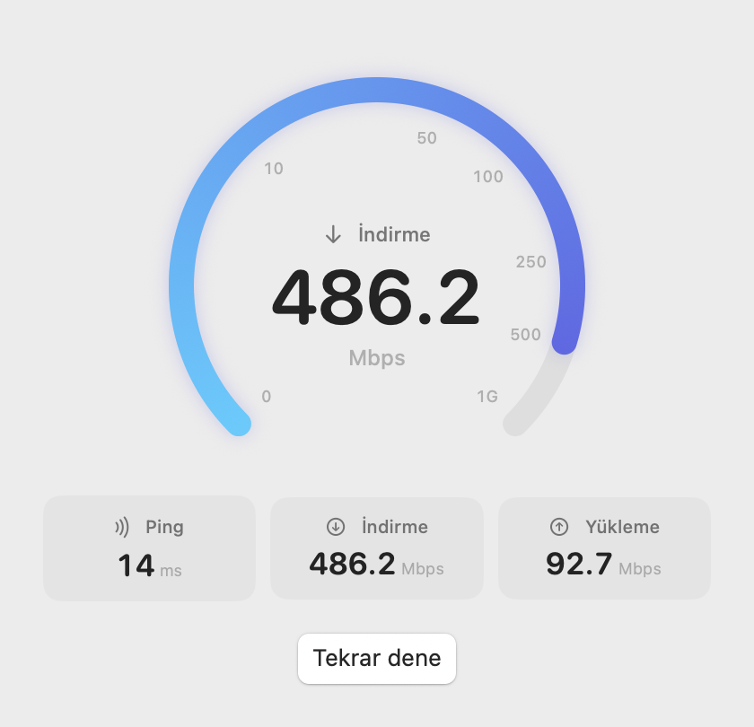

# Speed-Test

Menü çubuğunda sade hız testi. Simgeye tıkla, **Başla**'ya bas: ping, indirme ve yükleme hızı canlı ibreyle ölçülür.



## Nasıl ölçer

- Sunucular: Cloudflare'in herkese açık hız testi uç noktaları (`speed.cloudflare.com`). Hesap ya da anahtar gerekmez, kişisel veri gönderilmez.
- **Ping:** ilk istek bağlantıyı kurar ve sayılmaz; sonraki 5 isteğin ortancası.
- **İndirme / yükleme:** 4 paralel bağlantı. Hız ilk bayt geldikten sonra ölçülür, bağlantı kurma süresi sayılmaz. Her aşama en fazla 10 saniye sürer.
- İbre logaritmik ölçekli (0 – 1 Gbps). İndirme mavi, yükleme mor çizilir.

## Kurulum

Deponun kökünden:

```bash
./build.sh --install speed-test   # derle, /Applications'a kur ve aç
./build.sh speed-test             # yalnız derle → speed-test/build/Speed-Test.app
```

Gereksinimler ve imza sertifikası için [ana README](../README.md)'ye bakın.

## Yapı

```
speed-test/
├── Sources/SpeedTestKit/  SpeedTestModel (ölçüm) · SpeedTestView (ibre, sonuçlar)
└── Sources/SpeedTest/     App (menü çubuğu)
```

Aynı `SpeedTestKit` kütüphanesini [macOne](../macone/README.md) de kullanır.
