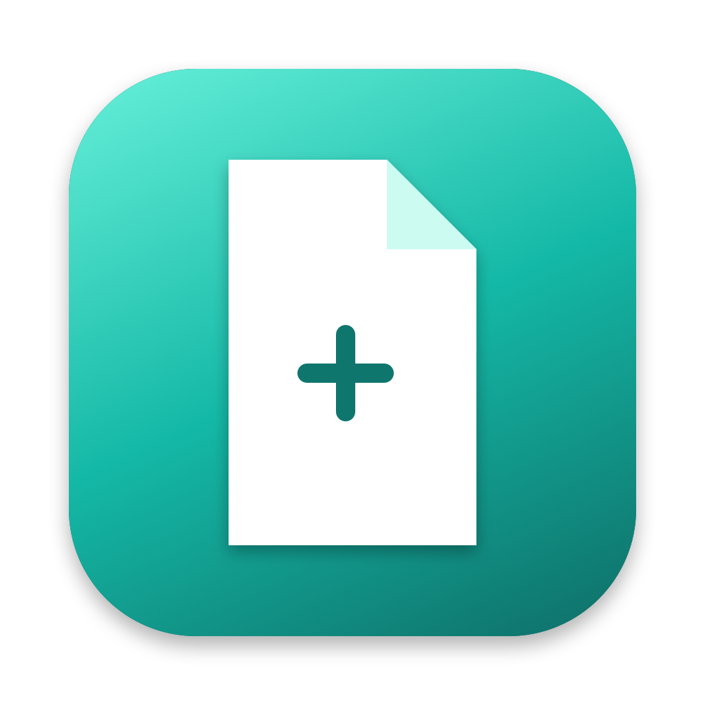

# Tabula



Finder'da klasörün boş yerine sağ tıklayınca **Yeni Dosya** menüsü açar. macOS'ta bu seçenek hazır gelmez. Tabula bunu bir Finder eklentisiyle ekler.

## Menüdeki türler

txt, md, json (içinde `{}`), csv, html, py ve sh (`#!/bin/sh` satırıyla).

Dosya "Yeni Dosya.txt" adıyla oluşur, ad doluysa "Yeni Dosya 2.txt" olur. Finder dosyayı seçili gösterir.

## Kurulum

Deponun kökünden:

```bash
./build.sh --install tabula   # derle, /Applications'a kur ve aç
./build.sh tabula             # yalnız derle → tabula/build/Tabula.app
```

Gereksinimler ve imza sertifikası için [ana README](../README.md)'ye bakın.

Tabula'yı bir kez açın. Eklentiyi kaydeder ve Finder'ı yeniden başlatır. Menü görünmezse: Sistem Ayarları → Genel → Oturum Açma Öğeleri ve Eklentiler → Finder → **Yeni Dosya**'yı açın.

## Yeni tür eklemek

[`Extension/FinderSync.swift`](Extension/FinderSync.swift) başındaki `types` listesine bir satır ekleyin (başlık, uzantı, ilk içerik), sonra `./build.sh --install tabula` çalıştırın.

## Nasıl çalışır

- Ana uygulama (`Sources/Tabula/main.swift`) yalnız eklentiyi etkinleştirir.
- Eklenti (`Extension/`) bir Finder Sync eklentisidir. Sandbox ister. Her klasöre yazabilmesi için `/` yolu için geçici yazma istisnası alır.
- `post-build.sh`, `build.sh` tarafından çağrılır. Eklentiyi derleyip uygulamanın içine koyar ve imzalar.
- Uygulama ağ erişimi kullanmaz.
- İkon: `swift tools/make_icon.swift` (tabula klasöründen).
